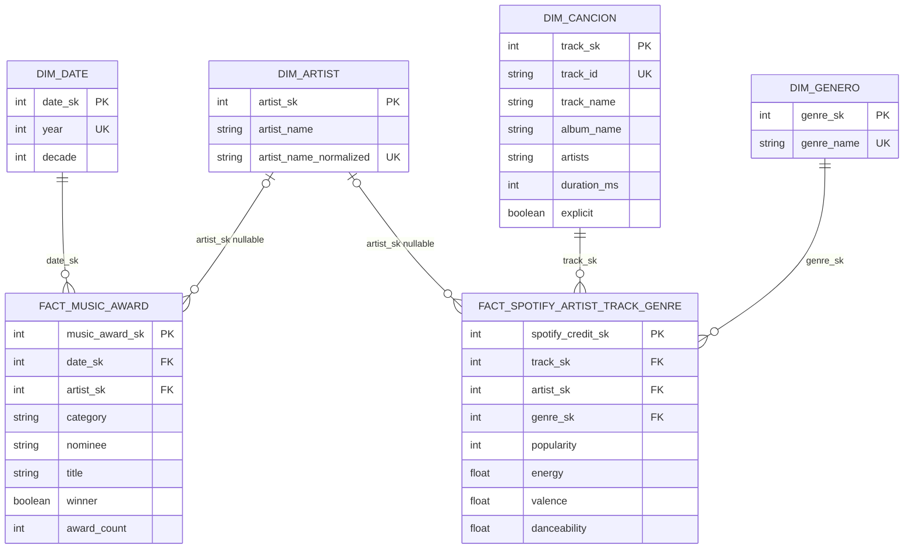
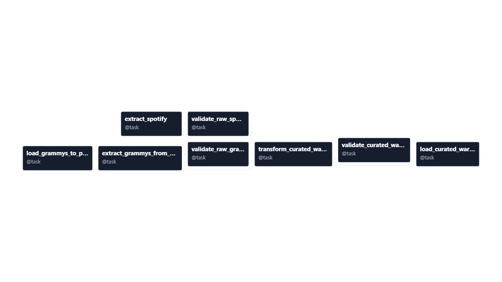

# Integración analítica de datos de Spotify y premios Grammy

<p align="center">
  <strong>Proyecto académico de integración, calidad de datos y modelamiento dimensional</strong><br>
  Catálogo musical de Spotify · Registros de premios Grammy
</p>

## 1. Problem and analytical objective

Spotify y los registros de los premios Grammy describen aspectos relacionados de la industria musical, pero tienen unidades de observación distintas. Spotify contiene canciones, características de audio, popularidad y créditos de artista; la fuente Grammy contiene registros de premios con año, categoría, artista asociado y estado ganador. Sin una estrategia explícita de integración, no es posible estudiar conjuntamente la presencia de artistas en ambas fuentes ni comparar características de popularidad con sus registros Grammy.

El objetivo analítico es integrar ambas fuentes a través de una dimensión compartida de artista, conservando el grano propio de cada conjunto de datos. La integración permitirá medir la presencia de registros Grammy ganadores entre los artistas acreditados en Spotify y comparar popularidad musical por género y por condición Grammy.

La unión de artistas se basa en nombres normalizados: se eliminan espacios externos, se compactan espacios internos consecutivos y se compara sin distinguir mayúsculas. Esta regla es determinista, pero no confirma que dos nombres correspondan a la misma persona ni resuelve alias u homónimos.

## 2. Analytical requirements

Los cuatro requerimientos siguientes reemplazan los cinco análisis anteriores. Los KPI que involucran registros Grammy deben interpretarse considerando la cobertura observada de la fuente.

| ID | Analytical Requirement | Required Data | Source(s) | Expected KPI(s) | Required Level of Detail | Why both sources are combined / traceability |
|---|---|---|---|---|---|---|
| R1 | ¿Qué porcentaje de los artistas distintos acreditados en Spotify tiene al menos un registro Grammy marcado como ganador? | Spotify: `artists`; Grammy: `artist`, `winner`. Ambas fuentes usan nombres normalizados para resolver el `artist_sk` compartido. | Spotify: catálogo CSV. Grammy: `workshop2.public.grammys`. | Porcentaje de artistas Spotify atribuibles con al menos un registro asociado a `winner = TRUE`; numerador y denominador de artistas distintos. | Una fila por artista distinto de Spotify; artistas no identificados se excluyen. | Es un KPI de cruce: el conjunto Spotify forma el denominador y los registros Grammy identifican los artistas ganadores. Se implementa mediante `dim_artist`, `fact_spotify_artist_track_genre` y `fact_music_award`. |
| R2 | ¿Cuál es la popularidad promedio de las canciones en cada género musical? | Spotify: `track_id`, `track_genre`, `popularity`; el promedio se calcula una sola vez por canción y género, aunque la canción tenga varios artistas. | Spotify: catálogo CSV. | Promedio de `popularity` por género y cantidad de canciones consideradas. | Género y canción-género; no se limita a un Top 10. | Es una métrica Spotify. El grano del hecho se expande por artista, por lo que el cálculo primero consolida las filas a canción-género para no ponderar canciones con más créditos. |
| R3 | ¿Cuáles son los cinco géneros asociados a más registros Grammy ganadores entre sus artistas acreditados en Spotify? | Spotify: `track_id`, `track_genre`, `artists`; Grammy: `artist`, `winner`, un registro por fila. | Spotify y `workshop2.public.grammys`. | Top 5 de géneros según la suma de `award_count` de registros Grammy `winner = TRUE`; se informa también el número de artistas Spotify distintos asociados a esos registros. | Género, tras deduplicar cada par artista-género; cada registro Grammy se cuenta una vez por género al que se asocia su artista. | El KPI requiere vincular los artistas entre fuentes y trasladar el género Spotify a cada artista. Un artista con varias canciones de un género no multiplica sus registros Grammy para ese género. |
| R4 | ¿Cómo difiere la popularidad promedio de las canciones por artista entre artistas con y sin registro Grammy ganador observado? | Spotify: `track_id`, `artists`, `track_genre`, `popularity`; Grammy: `artist`, `winner`. | Spotify y `workshop2.public.grammys`. | Popularidad promedio por artista y luego promedio de esas medias en cada grupo; cantidad de artistas por grupo. | Consolidar canción-género, promediar cada canción entre sus géneros, deduplicar artista-canción y formar los dos grupos de artistas. | Es un KPI de cruce: la dimensión compartida clasifica a cada artista Spotify según si tiene al menos un registro Grammy ganador observado. Canciones con varios artistas cuentan una vez para cada artista acreditado. |

### Alcance interpretativo

La tabla Grammy actualmente disponible contiene 4.809 registros observados y todos tienen `winner = TRUE`. Por tanto, R1, R3 y R4 se refieren a artistas asociados a registros ganadores observados; no miden la cobertura completa de nominados ni una tasa de victoria sobre todas las nominaciones. Los artistas sin una atribución de nombre usable permanecen en el hecho Grammy con `artist_sk` nulo y no se incluyen en los KPI de artistas.

## 3. Data sources

| Fuente | Ubicación y formato | Campos relevantes | Unidad de observación y limitaciones |
|---|---|---|---|
| Premios Grammy | El DAG limpia `data/raw/the_grammy_awards.csv`, lo carga una sola vez como fuente en PostgreSQL `workshop2.public.grammys` y lo extrae a un lote CSV inmutable. | `year`, `category`, `nominee`, `artist`, `winner`, `title`. | Una fila por registro Grammy de la tabla fuente. El lote perfilado tiene 4.809 registros, 638 categorías y `winner = TRUE` en todas las filas. `artist` falta en 1.840 registros (38,26 %), limitando los análisis atribuibles a artistas. |
| Catálogo Spotify | `data/raw/spotify_dataset.csv`; el DAG valida y genera un CSV normalizado. | `track_id`, `artists`, `track_genre`, `popularity`, `energy`, `valence`, `danceability`, además de atributos descriptivos de canción. | El archivo perfilado contiene 114.000 observaciones de canción-género y 114 géneros. Se encontraron 450 repeticiones excedentes en 444 claves duplicadas (`track_id`, `track_genre`); las filas repetidas concordaban en sus demás atributos. `artists` puede incluir varios nombres separados por `;`. |

**Por qué aparece una tabla `grammys` en PostgreSQL:** en el flujo implementado `grammys` es la tabla fuente/staging de `workshop2`, no una dimensión ni una tabla de hechos del almacén. El DAG primero carga allí el CSV Grammy limpio porque la extracción posterior consulta explícitamente `workshop2.public.grammys`. `grammys_source_load` es una tabla técnica adicional que conserva el hash y la procedencia del archivo cargado para evitar sobrescribir silenciosamente una fuente distinta. El cargador del almacén también apunta actualmente a la base `workshop2`; por eso ambas capas aparecen bajo la misma base, aunque cumplen funciones distintas. La carga analítica no copia `grammys` al conjunto de seis tablas dimensionales.

## 4. Data profiling and quality risk analysis

El perfilado que sustenta las reglas de calidad se hizo sobre los lotes de origen identificados arriba. Las cifras reflejan la versión perfilada y no deben interpretarse como garantía de los datos de futuras ejecuciones.

| Aspecto | Premios Grammy | Catálogo Spotify |
|---|---|---|
| **Structure** | 4.809 filas y 10 columnas: `year`, `title`, `published_at`, `updated_at`, `category`, `nominee`, `artist`, `workers`, `img`, `winner`. Campos usados por los requerimientos: `year`, `category`, `nominee`, `artist`, `winner`, `title`. | 114.000 filas y 20 campos de negocio, además de una columna inicial sin nombre que corresponde a un índice exportado. Campos usados: `track_id`, `artists`, `track_genre`, `popularity`, `energy`, `valence`, `danceability`. |
| **Completeness** | `artist`: 1.840 nulos (38,26 %); `nominee`: 6 (0,12 %); `workers`: 2.190 (45,54 %); `img`: 1.367 (28,40 %). Los campos `year`, `category` y `winner` no tenían nulos en el lote perfilado. La ausencia de `artist` impide atribuir esos registros a una persona; no se infiere el artista desde `nominee`. | `artists`, `album_name` y `track_name`: un nulo cada uno. Los campos requeridos para R2 y R3 (género, popularidad y créditos de artista usados para R1/R3/R4) deben comprobarse en cada gate; `popularity`, `energy`, `valence` y `danceability` no tenían nulos en el perfilado. |
| **Uniqueness and duplication** | No se confirmó una clave natural estable de fila. La repetición de años, categorías y artistas es esperada por el grano. Se observaron 1.658 formas exactas de nombre no nulas; mayúsculas/espacios normalizados consolidan variantes textuales, pero no validan identidad personal. | El grano requerido por la fuente es canción-género; `track_id` por sí solo no es único en las observaciones. El archivo presentaba 450 copias excedentes dentro de 444 claves repetidas de canción-género; las copias eran concordantes en los demás atributos. En la versión perfilada, 16.299 canciones aparecen en varios géneros. |
| **Categorical content** | 638 categorías; las más frecuentes fueron `Song Of The Year` (70), `Record Of The Year` (68) y `Album Of The Year` (66). `winner` solo contenía `TRUE` en las 4.809 filas; la fuente no permite observar ganadores y no ganadores conjuntamente. | 114 géneros, cada uno con 1.000 filas en el CSV original. `popularity` estaba en `[0,100]`; `energy`, `valence` y `danceability` en `[0,1]`. Para 720 canciones, `popularity` varía entre observaciones de género; la columna inicial sin nombre es un índice técnico, no una variable analítica. |
| **Evidence-based risks** | La alta proporción de artista faltante reduce el conjunto atribuible para cruces. La fuente ganadora solamente impide medir nominaciones completas y comparar ganadores con nominados no ganadores. La normalización nominal puede unir homónimos y no detecta alias. | Repeticiones de canción-género pueden inflar agregados; la expansión por artista puede volver a multiplicar las métricas si no se deduplican canción-género o artista-canción. La variación de popularidad entre géneros para una misma canción exige consolidar primero a nivel canción; `artists` multivaluado se expande para cruzar artistas, conservando una fila por crédito. |

**Tratamiento:** se preservan los archivos originales. Las copias concordantes de las claves canción-género se reducen a una observación; si hay valores contradictorios, la gate bloquea el lote. No se envían registros a cuarentena. Los errores estructurales, campos analíticos requeridos ausentes o referencias huérfanas también detienen la carga.

## 5. Propuesta del almacén dimensional

### 5.1 Grano y hechos

| Tabla de hechos | Grano de una fila | Medidas y uso |
|---|---|---|
| `fact_music_award` | Un registro Grammy observado en la fuente. | `award_count = 1`, para sumar registros observados por año o categoría. `winner` se conserva como atributo de contexto del registro. |
| `fact_spotify_artist_track_genre` | Un crédito de artista para una canción y un género: canción-artista-género. Una canción con *n* artistas produce *n* filas por cada género observado. Si no hay artista identificable, se conserva una fila con `artist_sk` nulo. | `popularity`, `energy`, `valence`, `danceability`. Son medidas Spotify replicadas por artista acreditado: antes de promediar por género se reduce a canción-género; para R4, primero se promedia la popularidad observada entre géneros por canción y después se reduce a artista-canción. |

Los dos hechos tienen granos diferentes porque representan fenómenos diferentes. Se integran con `dim_artist`; no se hace un join directo entre cada fila Grammy y cada fila de canción, lo que multiplicaría medidas.

### 5.2 Dimensiones, claves y preguntas que responden

| Dimensión | Claves y atributos | Preguntas que habilita |
|---|---|---|
| `dim_date` | `date_sk` (PK sustituta), `year` (clave de negocio única), `decade` (derivada). | Evolución de registros Grammy por año y agrupación temporal. Spotify no dispone de una fecha comparable en el conjunto usado. |
| `dim_artist` | `artist_sk` (PK sustituta), `artist_name`, `artist_name_normalized` (clave de negocio única). Se construye con nombres Grammy y créditos Spotify normalizados. | Porcentaje de artistas Spotify con un registro Grammy ganador; géneros asociados a artistas Grammy; comparación de popularidad con/sin registro ganador. |
| `dim_cancion` | `track_sk` (PK sustituta), `track_id` (clave de negocio única), `track_name`, `album_name`, `artists`, `duration_ms`, `explicit`. | Descripción y deduplicación de canciones Spotify. `artists` conserva el campo de origen, mientras que los créditos individuales se modelan en el hecho Spotify. |
| `dim_genero` | `genre_sk` (PK sustituta), `genre_name` (clave de negocio, derivada de `track_genre`). | Popularidad media por género y conteo de registros Grammy observados asociados a sus artistas. |


### 5.3 Claves, relaciones y estrategia de integración

Las claves sustitutas se generan en la transformación a partir de listas ordenadas. Son reproducibles para el mismo conjunto de entrada, pero no se consideran persistentes entre lotes distintos si cambia el contenido. Las claves de negocio se conservan para deduplicación y trazabilidad; no se sustituye el identificador de origen `track_id`.

| Hecho | Clave primaria | Claves foráneas / unicidad de grano |
|---|---|---|
| `fact_music_award` | `music_award_sk`, una clave técnica por registro de origen. | `date_sk` → `dim_date.date_sk`; `artist_sk` → `dim_artist.artist_sk` (nullable cuando falta una atribución); los atributos `category`, `nominee`, `title`, `winner` se guardan en el propio hecho. |
| `fact_spotify_artist_track_genre` | `spotify_credit_sk`, una clave sustituta por crédito. | `track_sk` → `dim_cancion.track_sk`; `artist_sk` → `dim_artist.artist_sk` (nullable si no se encuentra crédito); `genre_sk` → `dim_genero.genre_sk`. GX verifica la unicidad del grano `(track_sk, artist_sk, genre_sk)`. |



La integración ocurre antes de generar los dos hechos. La transformación extrae nombres de `grammys.artist` y separa los créditos `spotify.artists` por `;`; aplica la misma normalización y genera una única `dim_artist`. Ambas transformaciones resuelven `artist_sk` contra esa dimensión. Así se puede cruzar las fuentes por igualdad de clave sustituta sin emparejar filas de hechos. La normalización textual puede producir falsos emparejamientos de homónimos y no resuelve artistas con alias diferentes; estos resultados deben interpretarse como coincidencias nominales.

### 5.4 Trazabilidad de los requerimientos

| Requerimiento | Tablas y cálculo |
|---|---|
| R1 — porcentaje de artistas Spotify con Grammy ganador observado | Artistas distintos no nulos del hecho Spotify como denominador; artistas distintos con `winner = TRUE` en `fact_music_award` como numerador; unir por `artist_sk`. |
| R2 — popularidad promedio por género | Consolidar el hecho Spotify a una fila por `(genre_sk, track_sk)` y después calcular `AVG(popularity)` por género. |
| R3 — Top 5 de géneros según registros Grammy ganadores observados de sus artistas | Obtener pares distintos `(genre_sk, artist_sk)` desde Spotify, unir a los registros Grammy `winner = TRUE` y sumar `award_count` por género. |
| R4 — popularidad promedio por condición Grammy | Consolidar a canción-género, promediar esos valores por canción, reducir a artista-canción, calcular primero la media por artista, clasificar según existencia de registro ganador y promediar las medias de artistas en cada grupo. |

Las consultas ejecutables están en [`sql/analytical_queries.sql`](./sql/analytical_queries.sql).

## 6. Reglas de calidad y carga

Las gates de calidad raw para Grammy y Spotify, y la gate curada, aplican exactamente tres reglas cada una. Las reglas bloqueantes detienen la ejecución antes de la carga; no se descartan silenciosamente filas ni se genera cuarentena.

| ID | Regla | Métrica / umbral | Severidad y acción |
|---|---|---|---|
| GX01 | Estructura y esquema | 100 % de campos requeridos presentes en raw; columnas exactas, seis tablas curadas no vacías y claves primarias válidas en el modelo curado. | Crítica: bloquear el lote y reportar discrepancias. |
| GX02 | Completitud, dominios y métricas analíticas | Cero valores inválidos en los campos requeridos. Grammy: año en el rango permitido, categoría y ganador válidos. Spotify: popularidad `[0,100]`; `energy`, `valence`, `danceability` `[0,1]`. Curado: década consistente y medidas dentro de dominio. | Alta: bloquear el lote completo. `artist_sk` puede ser nulo conforme a las limitaciones perfiladas; no se crea un artista ficticio. |
| GX03 | Grano e integridad relacional | Cero duplicados contradictorios en canción-género raw, cero duplicados no resueltos en el grano canción-artista-género curado y cero referencias foráneas huérfanas. | Alta: bloquear. Las repeticiones concordantes canción-género se normalizan antes de transformar; no se genera cuarentena. |

El detalle del conteo aprobado/reprobado y las advertencias de cada regla se persiste en informes JSON por lote. La fuente Grammy genera una advertencia de cobertura si no contiene ambos resultados de `winner`.

## 7. Airflow DAG design

El DAG `grammys_spotify_data_quality` usa dos ramas de entrada que convergen en la transformación. Solo después de validar el modelo curado se carga el almacén.




El grafo separa extracción, calidad de cada fuente, transformación, calidad curada y carga. Grammy se bootstrappea antes de extraerse desde PostgreSQL; Spotify se normaliza en su gate raw. Las dos ramas deben aprobar antes de crear las seis tablas curadas. La carga verifica además los hashes de los CSV validados y reemplaza el snapshot del warehouse dentro de una transacción.

## 8. Failure and retry policy

- Las tareas tienen **cero reintentos automáticos** (`retries = 0`). Una falla requiere revisar el log/informe, corregir su causa y volver a ejecutar o reintentar manualmente la tarea apropiada.
- Las gates GX detienen el flujo ante una falla de severidad crítica o alta; no se continúa con una carga parcial. Los errores de extracción, estructura, claves, PostgreSQL o cambios de hash también elevan una excepción y fallan la tarea.
- Si falla la gate raw, la transformación no se ejecuta. Si falla la gate curada o la verificación de hashes, la carga no se ejecuta.
- El reemplazo del almacén es transaccional: errores durante truncado/inserción revierten la transacción, evitando publicar una carga incompleta. Los errores persistentes de datos no se reintentan automáticamente porque repetirlos no los corregiría.
- El esquema anterior no se renombra ni se elimina automáticamente. Si los nombres de tabla ya existen con columnas incompatibles, el cargador reporta el esquema inesperado y no intenta una migración destructiva. La limpieza de tablas históricas requiere una decisión explícita del operador.

## 9. Successful execution evidence

La evidencia exitosa disponible para el diseño integrado es una validación local reproducible, no una corrida completa nueva de Airflow:

| Etapa | Resultado observado |
|---|---|
| Grammy raw | 3/3 reglas GX aprobadas; 4.809 registros. |
| Spotify raw | 114.000 filas de entrada; 113.550 canción-género después de retirar 450 copias concordantes; cero filas en cuarentena. |
| Transformación y gate curada | 3/3 reglas GX aprobadas; contrato de columnas aceptado por el lector del cargador. |
| Tablas resultantes | `dim_date` 62; `dim_artist` 30.942; `dim_cancion` 89.741; `dim_genero` 114; `fact_music_award` 4.809; `fact_spotify_artist_track_genre` 157.529. |
| KPI preliminar R1 | 524 coincidencias de artistas ganadores observados entre 29.810 artistas Spotify atribuibles (1,76 %). |

Los informes de validación por lote se escriben en `data/batches/<fuente>/<lote>/validation_report.json`; en particular, el lote Grammy `simplified-model-final-20261014T0500` registra 3/3 aprobadas y la advertencia de cobertura `winner`.

## 10. Controlled failure evidence

El comportamiento de bloqueo está respaldado por dos evidencias:

1. Se ejecutó un ensayo local de la gate curada sobre copias temporales de las tablas, reemplazando un `genre_sk` válido por `999999999`. GX falló con `QualityGateFailure`; `curated-cross-source-relationships-and-grain` detectó 1 referencia inválida entre 24 comprobaciones, y el informe generado tuvo estado `failed`. La prueba no invocó la carga PostgreSQL ni modificó los CSV de trabajo.
2. El informe histórico `data/batches/spotify/scheduled__2026-10-13T00_00_00_00_00/validation_report.json` registra un lote Spotify bloqueado: fallaron la unicidad canción-género (`894` inesperados), duración positiva (`1`) y tempo positivo (`157`). Es evidencia real de bloqueo de una versión previa de la gate; no debe confundirse con las tres reglas vigentes.

Una prueba controlada solo valida la respuesta de GX: no cambia el CSV fuente ni escribe en PostgreSQL.

## 11. Repeatability strategy

- Los lotes Grammy y Spotify incluyen manifiestos con identificador de corrida, conteos y hash SHA-256. Grammy también exporta sus filas ordenadas por `source_row_number`; un lote con el mismo identificador solo se reutiliza si coinciden sus hashes.
- El bootstrap Grammy registra hash, tamaño, archivo de origen y total de filas en `grammys_source_load`. Si cambia la fuente respecto del bootstrap ya existente, el proceso falla en vez de sobrescribirla silenciosamente.
- Las dimensiones se construyen con claves de negocio ordenadas (año, artista normalizado, `track_id` y género), de forma que las claves sustitutas son deterministas para el mismo contenido de entrada. Las filas del hecho conservan el orden estable del lote fuente.
- La gate curada calcula SHA-256 antes y después de validar; la carga vuelve a comparar los hashes con los aprobados por GX.
- La carga aplica un reemplazo completo transaccional. Una repetición con las mismas fuentes genera el mismo conjunto lógico de tablas y conteos, sin anexar otra copia del snapshot.
- Se limita el DAG a una corrida activa (`max_active_runs=1`) y se desactiva el backfill automático (`catchup=False`).

## 12. Ejecución

Con Docker Desktop activo, desde la raíz del proyecto:

```powershell
docker compose config --quiet
docker compose up -d --build
```

Airflow se expone en [http://localhost:8081](http://localhost:8081). Ejecutar el DAG `grammys_spotify_data_quality`. El flujo extrae las fuentes, aplica las gates raw, construye los CSV curados, valida las seis tablas y solo entonces reemplaza transaccionalmente la instantánea del almacén PostgreSQL. La base Grammy fuente es `workshop2`; en Windows se expone PostgreSQL en `localhost:5433`, mientras que los contenedores se comunican por `postgres:5432`.

La corrida completa de Airflow para este diseño aún está pendiente. La ejecución local verificó gates y estructura; no confirmó el efecto de carga PostgreSQL ni el resultado en el DAG. Al correr el DAG, validar las cuatro consultas de [`sql/analytical_queries.sql`](./sql/analytical_queries.sql) en el almacén.

## 13. Assumptions and limitations

### Assumptions

- **Artist identity is name-based.** Grammy `artist` and individual names parsed from Spotify `artists` refer to the same artist when their normalized strings match after trimming, collapsing repeated whitespace, and case-folding. The pipeline does not consult an external artist registry.
- **A Spotify artist credit is one distinct name in the semicolon-separated `artists` field.** A song with multiple credited artists contributes a row for each artist and each observed genre. Measures repeated by this expansion must be deduplicated or aggregated at the intended analytical grain before computing KPIs.
- **A Grammy fact row is one source record.** `award_count = 1` counts observed rows, not a reconstructed nomination or award event. Category, nominee, title, and winner remain attributes of that record.
- **A Grammy winner match means an observed Grammy row with `winner = TRUE`.** All 4,809 rows in the profiled batch have that value; the interpretation is therefore limited to records present in this winner-biased source.
- **Genre-level popularity uses song-genre observations.** Each distinct song is counted once within each genre. For R4, where Spotify has different popularity values for some songs across genres, song popularity is assumed to be the arithmetic mean across that song's observed genres before artist-level aggregation.
- **Missing or unusable artist names are not imputed.** Such records remain available in the relevant source/fact data with a null artist key, but are excluded from artist-based cross-source KPIs.
- **The current source snapshots are the analytical population.** KPI values describe the data loaded into this project, rather than the full Spotify catalog or complete Grammy history.

### Limitations

- **Name matching can create false or missed links.** Homonymous artists can be incorrectly merged; aliases, name changes, punctuation differences, and alternate spellings can prevent a true match. The reported cross-source match percentage is a nominal match, not verified person-level identity.
- **Grammy coverage is incomplete for nomination analysis.** Since the profiled source contains only `winner = TRUE`, it cannot support the total number of nominees, a win rate, or a meaningful comparison of winners against non-winning nominees. R1, R3, and R4 describe observed winners only.
- **Artist attribution is incomplete.** `artist` is null in 1,840 of 4,809 profiled Grammy rows (38.26%). Those rows cannot contribute to artist-level joins or KPIs. The project deliberately does not infer an artist from `nominee` or `workers`.
- **Spotify popularity is a time-sensitive catalog attribute.** The dataset does not provide a capture timestamp suitable for trend analysis, so popularity KPIs are a snapshot and cannot be interpreted as popularity evolution over time.
- **Genres and credited artists reflect the Spotify dataset's representation.** The model does not validate that genre labels are a universal taxonomy or that every listed artist is a primary performer. A song assigned to several genres contributes to each of those genres in R2 and can associate an artist's observed Grammy records with each such genre in R3.
- **R4 is an unweighted comparison of artist-level means.** Every artist contributes one mean regardless of catalog size. A song shared by multiple credited artists contributes once to each credited artist's mean. The result is descriptive and does not establish that Grammy recognition causes popularity differences.
- **Surrogate keys are deterministic only for an unchanged input population and transformation.** They are generated during transformation from sorted business keys, not managed as persistent slowly changing dimensions. Adding or removing business keys can change surrogate-key assignments; facts and dimensions must therefore be refreshed together.
- **Automated quality handling is fail-fast, not quarantine-based.** The pipeline blocks a batch when blocking expectations fail; it does not repair conflicting duplicates or publish partially accepted rows.
- **End-to-end deployment evidence remains incomplete.** Local validation confirmed the raw and curated GX gates and the loader's CSV schema contract, but the latest integrated model has not yet been verified by a complete Airflow run, PostgreSQL warehouse load, and execution of all analytical queries.

## 14. Tecnologías

| Componente | Uso |
|---|---|
| Apache Airflow | Orquestación de extracción, gates, transformación y carga. |
| Great Expectations | Validación de calidad en origen y en el modelo curado. |
| PostgreSQL | Fuente de registros Grammy y destino del almacén. |
| Pandas | Perfilado y transformación de los CSV. |
| Docker Compose | Ejecución local de servicios. |
# workshop2
