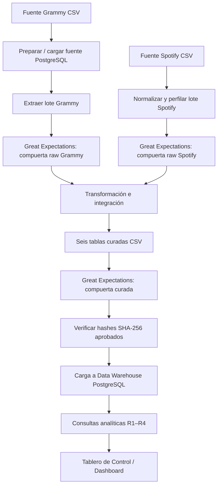
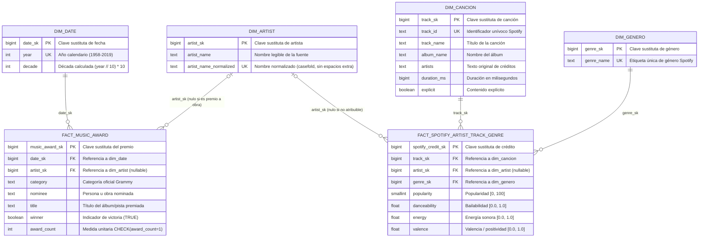

# Integración analítica de datos de Spotify y premios Grammy

> **Estado del proyecto:** las validaciones raw y curadas cuentan con evidencia de ejecución local. La ejecución integrada completa en Airflow, la carga verificada en PostgreSQL, la demostración de *safe rerun* y un dashboard consultando el data warehouse siguen pendientes de evidencia end-to-end.

## 1. Problema y objetivo analítico

Spotify describe canciones, artistas y géneros; los registros Grammy describen registros de premios. Las fuentes tienen granos distintos, por lo que una unión (`JOIN`) directa entre sus filas puede multiplicar medidas y producir indicadores incorrectos.

**Objetivo:** integrar ambas fuentes mediante una dimensión compartida de artista, conservar el grano de cada fuente y construir un almacén dimensional validado que permita responder cuatro requerimientos analíticos.

## 2. Requerimientos analíticos

| ID | Pregunta analítica | KPI / salida | Regla de cálculo y trazabilidad |
|---|---|---|---|
| R1 | ¿Qué porcentaje de artistas distintos acreditados en Spotify tiene al menos un registro Grammy ganador observado? | Porcentaje, numerador y denominador de artistas distintos. | Cruzar artistas Spotify y registros Grammy con `winner = TRUE` por `artist_sk`. Excluir créditos Spotify sin artista identificable. |
| R2 | ¿Cuál es la popularidad promedio de las canciones por género? | Popularidad promedio y número de canciones por género. | Consolidar a una fila por `(track_id, track_genre)` antes de calcular la media; una canción cuenta una vez por género, independientemente del número de artistas. |
| R3 | ¿Cuáles son los cinco géneros asociados a más registros Grammy ganadores observados entre artistas acreditados en Spotify? | Top 5 de géneros, registros Grammy observados y artistas Spotify distintos asociados. | Deduplicar los pares artista-género antes de relacionarlos con los registros Grammy ganadores. Cada registro se cuenta una vez por género al que se asocia el artista. |
| R4 | ¿Cómo difiere la popularidad promedio por artista entre quienes tienen y no tienen un registro Grammy ganador observado? | Media de las medias por artista y número de artistas por grupo. | Consolidar canción-género; promediar la popularidad por canción; deduplicar artista-canción; calcular la media por artista y comparar grupos. |

Consultas: [`sql/analytical_queries.sql`](./sql/analytical_queries.sql).

## 3. Fuentes de datos

| Fuente | Ubicación / carga | Grano y campos relevantes | Limitaciones identificadas |
|---|---|---|---|
| Grammy | `data/raw/the_grammy_awards.csv`; se prepara y carga en PostgreSQL como `workshop2.public.grammys`, y luego se extrae a un lote CSV. | Un registro por fila de la fuente. Campos: `year`, `category`, `nominee`, `artist`, `winner`, `title`. | En el lote perfilado: 4.809 filas; `artist` nulo en 1.840 (38,26 %); todas las filas tienen `winner = TRUE`. |
| Spotify | `data/raw/spotify_dataset.csv`; el DAG valida y normaliza un CSV. | Una observación por canción-género. Campos principales: `track_id`, `artists`, `track_genre`, `popularity`, `energy`, `valence`, `danceability`. | 114.000 filas originales, 114 géneros y 450 copias excedentes en 444 claves `(track_id, track_genre)`. `artists` puede contener varios nombres separados por `;`. |

Los archivos originales se conservan sin modificaciones. Los conteos corresponden a los lotes perfilados y deben volver a comprobarse en cada ejecución.

## 4. Hallazgos del perfilado y riesgos de calidad

| Hallazgo del perfilado | Riesgo analítico | Tratamiento / control |
|---|---|---|
| Grammy: 1.840 valores `artist` nulos (38,26 %); `nominee` tiene 6 nulos. | Los registros sin artista no pueden atribuirse de forma confiable a una persona. | Conservar el registro y permitir `artist_sk` nulo; no inferir el artista desde `nominee` ni `workers`. Excluirlo de KPI por artista. |
| Grammy: 4.809 filas, 638 categorías; `winner = TRUE` en todas. | No se puede comparar ganadores con no ganadores ni calcular una tasa de éxito entre nominaciones completas. | Interpretar los resultados como registros ganadores observados en esta fuente. Emitir advertencia de cobertura. |
| Spotify: 114.000 filas; 450 copias excedentes en 444 claves canción-género. | La duplicación puede sobreponderar canciones y alterar promedios. | Reducir repeticiones concordantes a una fila por clave. Si hay valores contradictorios, bloquear el lote. |
| Spotify: 16.299 canciones aparecen en varios géneros; para 720 canciones cambia la popularidad entre observaciones de género. | La expansión por género o artista puede multiplicar medidas. | Reagrupar al grano requerido antes de calcular cada KPI. Para R4, usar la media aritmética de popularidad por canción entre los géneros observados. |
| Spotify: 114 géneros, 1.000 filas por género en el archivo original; `popularity` en `[0,100]`; `energy`, `valence` y `danceability` en `[0,1]`. | Valores fuera de dominio pueden invalidar las métricas. | Validar tipos, completitud y rangos en cada lote. No recortar ni inventar valores. |
| La normalización de nombres no verifica identidad real. | Homónimos pueden unirse incorrectamente y los alias pueden quedar separados. | Coincidencia nominal exacta tras normalización; documentar la incertidumbre. |

**Política de excepciones:** falla rápida (*fail-fast*). No se descartan silenciosamente filas ni se publica una carga parcial. No hay cuarentena implementada. Las copias concordantes se deduplican por una regla explícita; duplicados contradictorios, errores estructurales, dominios inválidos y claves foráneas huérfanas bloquean el flujo.

## 5. Arquitectura de la tubería de datos



**Principio de control:** ninguna transformación debe continuar si falla una compuerta *raw*; ninguna carga debe ejecutarse si falla la compuerta curada o si los archivos cambian después de validarse.

## 6. Riesgos de calidad y reglas de validación (Great Expectations)

En cumplimiento de los requerimientos de ingeniería de datos y la sección 6.5 del taller, el pipeline implementa validaciones automáticas con **Great Expectations (v1.24.0)** en tres etapas clave: **Spotify Raw**, **Grammy Raw** y **Data Warehouse Curado**. 

Para cada conjunto de datos se validan rigurosamente tres aspectos: **columnas requeridas**, **valores permitidos / dominios** y **filas repetidas / unicidad del grano**.

La especificación técnica completa y la justificación basada en perfilado se encuentra en [`docs/quality_rules.md`](./docs/quality_rules.md).

### Matriz de Reglas de Calidad por Conjunto de Datos

| ID de Regla | Conjunto de Datos / Capa | Qué se revisa | Qué se considera aceptable | Qué tan grave es si falla (Severidad / Política) | Requerimiento Protegido |
|---|---|---|---|---|---|
| **R-SPOT-01-COLS** | Spotify Crudo (*Raw*) | Presencia de las columnas obligatorias: `track_id`, `track_genre`, `popularity`, `duration_ms`, `danceability`, `energy`, `valence`, `artists`, `track_name`, `album_name`. | 100% de columnas requeridas presentes en el lote (0 faltantes). | **Crítica:** detiene el pipeline de inmediato (*fail-fast*). Impide transformaciones fallidas por ausencia de campos. | R1, R2, R3, R4 |
| **R-SPOT-02-VALS** | Spotify Crudo (*Raw*) | Dominios y completitud: `popularity` en $[0, 100]$; `danceability`, `energy`, `valence` en $[0.0, 1.0]$; `track_id` y `track_genre` no nulos ni vacíos. | Cero valores fuera de rango o nulos en identificadores y géneros (0.0% de error). | **Alta:** bloquea el lote (*fail-fast*). Prohibida la imputación de valores para no distorsionar promedios. | R2, R4 |
| **R-SPOT-03-DUPS** | Spotify Crudo / Preparado | Filas repetidas en el grano `(track_id, track_genre)`. Detección de duplicados concordantes vs contradictorios. | En crudo: duplicados idénticos se reducen a 1 fila (113.550 filas). En normalizado: 100% unicidad estricta en el grano. Cero duplicados contradictorios. | **Crítica:** bloquea si hay conflicto de atributos; advierte y deduplica si son idénticos. Evita sobreponderar canciones. | R2, R4 |
| **R-GRAM-01-COLS** | Grammy Crudo (PostgreSQL) | Esquema exacto de las 10 columnas extraídas: `year`, `title`, `published_at`, `updated_at`, `category`, `nominee`, `artist`, `workers`, `img`, `winner`. | Coincidencia exacta del conjunto de 10 columnas (0 diferencias). | **Crítica:** detiene el pipeline. Falla contractualmente si cambia la tabla relacional de origen. | R1, R3 |
| **R-GRAM-02-VALS** | Grammy Crudo (PostgreSQL) | `year` numérico en $[1900, 2026]$; `category`, `year`, `winner` no nulos; `winner` interpretable como booleano; monitoreo de `artist` nulo. | 100% no-nulos en campos clave. Se tolera $\le 40\%$ de nulos en `artist` (38.26% identificado en perfilado). | **Crítica** en `year`/`category`/`winner`; **Advertencia** en nulos de `artist` (se preservan con `artist_sk = NULL`). | R1, R3, R4 |
| **R-GRAM-03-DUPS** | Grammy Crudo (PostgreSQL) | Unicidad de los registros de premiación; ausencia de filas redundantes en la tupla `(year, category, nominee, title, artist)`. | Cero filas duplicadas (100% registros únicos en el lote). | **Alta:** bloquea la tubería. Evita inflar artificialmente la medida `award_count`. | R1, R3 |
| **R-CUR-01-COLS** | Almacén Curado (Data Warehouse) | Esquema y materialización de las 6 tablas (`dim_date`, `dim_artist`, `dim_cancion`, `dim_genero`, `fact_music_award`, `fact_spotify_artist_track_genre`). | Las 6 tablas existen, tienen filas ($> 0$) y coinciden exactamente con el esquema estrella. | **Crítica:** no cargar al Data Warehouse en PostgreSQL. | R1, R2, R3, R4 |
| **R-CUR-02-VALS** | Almacén Curado (Data Warehouse) | Integridad referencial (claves foráneas sin huérfanos), `award_count = 1`, `winner` booleano, y consistencia matemática de `decade`. | Cero claves huérfanas (100% integridad referencial), 100% medidas en rango y recuentos unitarios. | **Crítica:** bloquea la carga transaccional para evitar fallos de claves foráneas o medidas erróneas. | R1, R2, R3, R4 |
| **R-CUR-03-DUPS** | Almacén Curado (Data Warehouse) | Unicidad estricta de claves primarias sustitutas en las 6 tablas, unicidad de claves de negocio normalizadas y unicidad del grano `(track_sk, artist_sk, genre_sk)`. | Cero duplicados en claves primarias, claves de negocio y grano analítico (100% de unicidad). | **Crítica:** bloquea la carga. Evita duplicación de hechos o errores de clave primaria en base de datos. | R1, R2, R3, R4 |

### Compuerta curada obligatoria

La suite `curated_warehouse_suite`, ejecutada mediante `gx.curated_validation.run_validation`, valida de forma multi-asset las seis tablas de `data/transform` antes de invocar `load_curated_warehouse`:
- Escribe el reporte de auditoría `data/transform/curated_validation_report.json`.
- El DAG en Airflow computa huellas SHA-256 antes y después de la validación; el cargador verifica que la suite haya pasado sin fallas bloqueantes y que los hashes aprobados no hayan sufrido modificaciones (*data tampering prevention*).
- Si se detecta una clave huérfana o un grano duplicado, se produce una excepción `QualityGateFailure` que cancela la carga a PostgreSQL sin publicar un estado parcial.

## 7. Estrategia de transformación e integración

| Transformación | Regla aplicada | Manejo de excepciones e impacto |
|---|---|---|
| Preparación Grammy | Verificar encabezado y número de campos; quitar espacios externos; validar año y título; normalizar `winner` a booleano. | Filas con estructura incorrecta, año no interpretable o título vacío no se cargan a la fuente. Valores `winner` desconocidos hacen fallar la compuerta. El original no se sobrescribe. |
| Preparación Spotify | Retirar la columna inicial sin nombre solo si se confirma que es un índice secuencial; convertir métricas a tipos numéricos y normalizar identificadores y géneros. | Columna inesperada, índice no secuencial, métricas no numéricas o fuera de dominio: error o compuerta fallida. No inventar valores. |
| Duplicados Spotify | Grano de origen `(track_id, track_genre)`; colapsar solo repeticiones concordantes. | Si una clave repetida presenta valores distintos en otros campos, bloquear el lote. Evita sobreponderar R2–R4. |
| Artistas compartidos | Separar `artists` por `;`; quitar espacios externos, colapsar espacios repetidos y aplicar `casefold`; unir nombres normalizados en `dim_artist`. | No resolver alias, puntuación, acentos ni homónimos con una autoridad externa. Nombres vacíos o no coincidentes conservan clave nula o quedan separados. |
| Hecho Grammy | Convertir `year` a entero, crear `dim_date` por año y derivar `decade = floor(year / 10) * 10`. Cada fila válida produce `award_count = 1`. | La compuerta bloquea año, categoría o ganador inválidos; no se sustituyen. Se conserva una fila por registro válido de origen. |
| Hecho Spotify | Crear dimensiones de canción y género; expandir cada observación canción-género a sus artistas distintos. Grano final: canción-artista-género. | Canciones con varios artistas producen una fila por crédito. Artista puede ser nulo. Se eliminan combinaciones repetidas y se valida la unicidad del grano. |
| Popularidad para R4 | Promediar la popularidad de una canción entre los géneros observados; luego deduplicar artista-canción. | Evita seleccionar arbitrariamente un género y evita multiplicar una canción por el número de géneros o créditos. |

### Contrato de integración

| Elemento | Decisión |
|---|---|
| Clave de integración | `artist_name_normalized`, convertida a la clave sustituta común `artist_sk`. |
| Normalización | Recortar espacios externos, colapsar espacios internos repetidos y comparar sin distinguir mayúsculas/minúsculas. Separar primero los créditos Spotify por `;`. |
| Cardinalidad | Un nombre normalizado corresponde a una fila de `dim_artist`. Un registro Grammy se asocia con cero o un artista; una observación canción-género puede producir varios créditos de artista. |
| No coincidencias | Las claves de artista nulas se reportan como advertencias y se excluyen de KPI por artista. No se infieren identidades. |
| Control de duplicados | Unicidad de `artist_name_normalized` y del grano `(track_sk, artist_sk, genre_sk)`. |
| Límite | La coincidencia textual no prueba identidad personal; no se detectan automáticamente alias ni homónimos. |

## 8. Modelo dimensional

El almacén analítico se implementa bajo un esquema en estrella multievento (constelación de hechos) en PostgreSQL (`workshop2.public`). Ambas fuentes convergen a través de la dimensión compartida conforme `dim_artist`, permitiendo responder los requerimientos analíticos sin forzar una unión directa fila a fila que multiplicaría medidas espuriamente.

---

### Diagrama del modelo dimensional (Hechos vs Dimensiones)

A continuación se presenta la separación estructural del modelo, ubicando en un bloque las **Dimensiones** (entidades de contexto) y en el otro los **Hechos** (eventos numéricos transaccionales), junto con sus atributos y claves:

```mermaid
flowchart LR
    %% Subgrafo de Dimensiones
    subgraph Dimensiones ["CAPA DE DIMENSIONES (Contexto Descriptivo)"]
        direction TB
        D_DATE["<b>dim_date</b><br/>━━━━━━━━━━━━━━━━━━<br/>🔑 date_sk: BIGINT (PK)<br/>📅 year: INT (UK)<br/>📊 decade: INT"]
        D_ARTIST["<b>dim_artist</b><br/>━━━━━━━━━━━━━━━━━━<br/>🔑 artist_sk: BIGINT (PK)<br/>👤 artist_name: TEXT<br/>🏷️ artist_name_normalized: TEXT (UK)"]
        D_CANCION["<b>dim_cancion</b><br/>━━━━━━━━━━━━━━━━━━<br/>🔑 track_sk: BIGINT (PK)<br/>🎵 track_id: TEXT (UK)<br/>💿 track_name: TEXT<br/>📁 album_name: TEXT<br/>👥 artists: TEXT<br/>⏱️ duration_ms: BIGINT<br/>🔞 explicit: BOOLEAN"]
        D_GENERO["<b>dim_genero</b><br/>━━━━━━━━━━━━━━━━━━<br/>🔑 genre_sk: BIGINT (PK)<br/>🎸 genre_name: TEXT (UK)"]
    end

    %% Subgrafo de Hechos
    subgraph Hechos ["CAPA DE HECHOS / FACTS (Eventos y Métricas)"]
        direction TB
        F_AWARD["<b>fact_music_award</b><br/>━━━━━━━━━━━━━━━━━━<br/>🔑 music_award_sk: BIGINT (PK)<br/>🔗 date_sk: BIGINT (FK)<br/>🔗 artist_sk: BIGINT (FK, nulo)<br/>🏆 category: TEXT<br/>⭐ nominee: TEXT<br/>📜 title: TEXT<br/>✔️ winner: BOOLEAN<br/>📈 award_count: INT (= 1)"]
        F_SPOTIFY["<b>fact_spotify_artist_track_genre</b><br/>━━━━━━━━━━━━━━━━━━<br/>🔑 spotify_credit_sk: BIGINT (PK)<br/>🔗 track_sk: BIGINT (FK)<br/>🔗 artist_sk: BIGINT (FK, nulo)<br/>🔗 genre_sk: BIGINT (FK)<br/>🔥 popularity: SMALLINT [0,100]<br/>💃 danceability: FLOAT [0,1]<br/>⚡ energy: FLOAT [0,1]<br/>✨ valence: FLOAT [0,1]"]
    end

    %% Relaciones foráneas desde Hechos hacia Dimensiones
    F_AWARD -->|date_sk| D_DATE
    F_AWARD -->|artist_sk (opcional)| D_ARTIST
    F_SPOTIFY -->|artist_sk (opcional)| D_ARTIST
    F_SPOTIFY -->|track_sk| D_CANCION
    F_SPOTIFY -->|genre_sk| D_GENERO
```

#### Diagrama de Entidad-Relación Detallado (ERD)



---

### Catálogo detallado de atributos por tabla

#### 1. Tablas de Dimensiones (Contexto Analítico)

##### A. `dim_date` (Dimensión Temporal)
- **Propósito:** Contexto temporal de premiaciones Grammy.
- **Grano:** Un año calendario observado en las ediciones Grammy.

| Atributo | Tipo de Dato (PostgreSQL) | Restricción | Descripción analítica |
|---|---|---|---|
| `date_sk` | `BIGINT` | `PRIMARY KEY` | Clave sustituta determinista generada en orden ascendente de años. |
| `year` | `INTEGER` | `NOT NULL, UNIQUE` | Año calendario de la edición de entrega del premio Grammy ($1958 - 2019$). |
| `decade` | `INTEGER` | `NOT NULL` | Década analítica calculada mediante `(year // 10) * 10`. |

##### B. `dim_artist` (Dimensión Conforme de Artista)
- **Propósito:** Entidad puente que integra artistas de Spotify con registros de premios Grammy.
- **Grano:** Un artista único normalizado.

| Atributo | Tipo de Dato (PostgreSQL) | Restricción | Descripción analítica |
|---|---|---|---|
| `artist_sk` | `BIGINT` | `PRIMARY KEY` | Clave sustituta determinista común compartida entre ambas fuentes. |
| `artist_name` | `TEXT` | `NOT NULL` | Nombre legible y representativo del artista extraído de las fuentes. |
| `artist_name_normalized` | `TEXT` | `NOT NULL, UNIQUE` | Nombre normalizado (espacios recortados, colapsados y en minúsculas `casefold`) para coincidencia exacta determinista. |

##### C. `dim_cancion` (Dimensión Canción)
- **Propósito:** Catálogo descriptivo y deduplicación de canciones de Spotify.
- **Grano:** Una canción única identificada por su `track_id`.

| Atributo | Tipo de Dato (PostgreSQL) | Restricción | Descripción analítica |
|---|---|---|---|
| `track_sk` | `BIGINT` | `PRIMARY KEY` | Clave sustituta determinista de la canción. |
| `track_id` | `TEXT` | `NOT NULL, UNIQUE` | Identificador alfanumérico único natural de Spotify. |
| `track_name` | `TEXT` | `NULLABLE` | Título de la pista musical. |
| `album_name` | `TEXT` | `NULLABLE` | Nombre del álbum de lanzamiento. |
| `artists` | `TEXT` | `NULLABLE` | Cadena original completa de créditos de artistas (separados por `;`). |
| `duration_ms` | `BIGINT` | `NULLABLE` | Duración de la canción en milisegundos. |
| `explicit` | `BOOLEAN` | `NULLABLE` | Indicador booleano de contenido explícito. |

##### D. `dim_genero` (Dimensión Género Musical)
- **Propósito:** Clasificación temática de canciones para agregación analítica.
- **Grano:** Un género musical único de Spotify (114 géneros observados).

| Atributo | Tipo de Dato (PostgreSQL) | Restricción | Descripción analítica |
|---|---|---|---|
| `genre_sk` | `BIGINT` | `PRIMARY KEY` | Clave sustituta determinista del género musical. |
| `genre_name` | `TEXT` | `NOT NULL, UNIQUE` | Nombre estandarizado del género musical en Spotify. |

---

#### 2. Tablas de Hechos (Facts)

##### A. `fact_music_award` (Hechos de Premiaciones Grammy)
- **Proceso de negocio:** Registro histórico de premios y nominaciones Grammy.
- **Grano de la tabla:** Un registro individual de premiación observado en la fuente Grammy.
- **Regla de integridad:** `award_count = 1` en cada fila. No se infiere identidad si el artista es nulo.

| Atributo | Tipo de Dato (PostgreSQL) | Restricción | Rol y Descripción |
|---|---|---|---|
| `music_award_sk` | `BIGINT` | `PRIMARY KEY` | Clave sustituta única del evento de premiación. |
| `date_sk` | `BIGINT` | `NOT NULL, FK -> dim_date(date_sk)` | Clave foránea temporal hacia el año de premiación. |
| `artist_sk` | `BIGINT` | `NULLABLE, FK -> dim_artist(artist_sk)` | Clave foránea al artista premiado. Nulo cuando el premio reconoce un álbum, composición o categoría institucional sin artista unívoco. |
| `category` | `TEXT` | `NOT NULL` | Categoría oficial de premiación otorgada por The Recording Academy. |
| `nominee` | `TEXT` | `NULLABLE` | Persona, álbum, composición o proyecto nominado. |
| `title` | `TEXT` | `NULLABLE` | Título del trabajo artístico galardonado. |
| `winner` | `BOOLEAN` | `NULLABLE` | Indicador de victoria (`TRUE` en todos los registros del conjunto observado). |
| `award_count` | `INTEGER` | `NOT NULL, CHECK (award_count = 1)` | Métrica aditiva unitaria que cuenta exactamente un registro de premiación observado. |

##### B. `fact_spotify_artist_track_genre` (Hechos de Observaciones de Canciones Spotify)
- **Proceso de negocio:** Desempeño musical, métricas acústicas y popularidad por crédito de artista.
- **Grano de la tabla:** Un crédito de artista individual para una canción y un género musical observado (`track_sk`, `artist_sk`, `genre_sk`).
- **Regla de integridad:** Restricción de unicidad estricta en el grano `UNIQUE (track_sk, artist_sk, genre_sk)`.

| Atributo | Tipo de Dato (PostgreSQL) | Restricción | Rol y Descripción |
|---|---|---|---|
| `spotify_credit_sk` | `BIGINT` | `PRIMARY KEY` | Clave sustituta única del crédito individual de artista. |
| `track_sk` | `BIGINT` | `NOT NULL, FK -> dim_cancion(track_sk)` | Clave foránea hacia la dimensión canción. |
| `artist_sk` | `BIGINT` | `NULLABLE, FK -> dim_artist(artist_sk)` | Clave foránea hacia la dimensión de artista (nulo si no hay crédito atribuible). |
| `genre_sk` | `BIGINT` | `NOT NULL, FK -> dim_genero(genre_sk)` | Clave foránea hacia la dimensión género musical. |
| `popularity` | `SMALLINT` | `NOT NULL, CHECK (popularity BETWEEN 0 AND 100)` | Métrica de popularidad calculada por el algoritmo de Spotify ($0 - 100$). |
| `danceability` | `DOUBLE PRECISION` | `NOT NULL, CHECK (danceability BETWEEN 0 AND 1)` | Métrica de idoneidad para el baile basada en tempo, ritmo y regularidad ($0.0 - 1.0$). |
| `energy` | `DOUBLE PRECISION` | `NOT NULL, CHECK (energy BETWEEN 0 AND 1)` | Métrica perceptual de intensidad, velocidad y sonoridad ($0.0 - 1.0$). |
| `valence` | `DOUBLE PRECISION` | `NOT NULL, CHECK (valence BETWEEN 0 AND 1)` | Métrica de positividad sonora transmitida por la canción ($0.0 - 1.0$). |

---

### Trazabilidad: Requerimientos Analíticos → Almacén de Datos

| ID | Requerimiento Analítico | Tablas y Elementos del Data Warehouse Utilizados | Lógica de Cálculo |
|---|---|---|---|
| **R1** | Porcentaje de artistas Spotify con Grammy ganador observado. | `fact_spotify_artist_track_genre`, `fact_music_award`, `dim_artist`. | Cruzar artistas Spotify no nulos con artistas Grammy con `winner = TRUE` usando `artist_sk`. Numerador: `COUNT(DISTINCT artist_sk)` coincidentes. Denominador: `COUNT(DISTINCT artist_sk)` en Spotify. |
| **R2** | Popularidad promedio y conteo de canciones por género musical. | `fact_spotify_artist_track_genre`, `dim_genero`, `dim_cancion`. | Agrupar previamente por `(genre_sk, track_sk)` tomando `MAX(popularity)` para contar cada canción una sola vez por género; unir con `dim_genero` y calcular `AVG(popularity)` y `COUNT(track_sk)`. |
| **R3** | Top 5 géneros asociados a más premios Grammy ganadores. | `fact_spotify_artist_track_genre`, `fact_music_award`, `dim_genero`. | Deduplicar los pares `(genre_sk, artist_sk)` en Spotify; unirlos por `artist_sk` con `fact_music_award` donde `winner = TRUE`; agrupar por `genre_name` y calcular `SUM(award_count)` ordenando descendente con límite 5. |
| **R4** | Comparación de popularidad media por artista entre ganadores y no ganadores. | `fact_spotify_artist_track_genre`, `fact_music_award`, `dim_artist`. | Para cada canción, calcular su popularidad media entre sus géneros observados; asignar esa popularidad a cada crédito `artist_sk`; promediar por artista; etiquetar si el artista tiene `winner = TRUE` en `fact_music_award`; comparar la media de las medias y el tamaño de cada grupo. |


## 9. Diseño del flujo en Apache Airflow (DAG)

DAG: `grammys_spotify_data_quality`.

| Fase | Responsabilidad | Condición para avanzar |
|---|---|---|
| Bootstrap / extracción Grammy | Preparar la fuente PostgreSQL y extraer un lote CSV identificado. | Extracción y estructura correctas. |
| Compuerta raw Grammy | Validar esquema, completitud, dominios y calidad del lote mediante Great Expectations. | Todas las reglas bloqueantes aprobadas (`R-GRAM-01-COLS`, `R-GRAM-02-VALS`, `R-GRAM-03-DUPS`). |
| Preparación y compuerta raw Spotify | Normalizar el CSV y validar el grano y los dominios. | Todas las reglas bloqueantes aprobadas (`R-SPOT-01-COLS`, `R-SPOT-02-VALS`, `R-SPOT-03-DUPS`). |
| Transformación e integración | Construir las cuatro dimensiones y los dos hechos curados. | Ambas ramas de origen aprobadas. |
| Compuerta curada (DW) | Validar esquema, dominios, claves, integridad referencial y grano en las 6 tablas. | Expectativas bloqueantes aprobadas (`R-CUR-01-COLS`, `R-CUR-02-VALS`, `R-CUR-03-DUPS`) y hashes consistentes. |
| Carga transaccional al DW | Reemplazar la instantánea (*snapshot*) en PostgreSQL dentro de una transacción ACID. | Compuerta curada y verificación de hashes SHA-256 aprobadas. |
| Generación de salidas analíticas | Ejecutar las cuatro consultas de `sql/analytical_queries.sql`. | Carga en PostgreSQL confirmada. |


La imagen documenta el diseño del DAG orquestador. La ejecución integrada completa se gestiona en Airflow mediante tareas desacopladas TaskFlow; una validación local aislada no sustituye la trazabilidad de una corrida *end-to-end*.

## 10. Política de fallos y reintentos

**Configuración actual:** `retries = 0`. No hay reintentos automáticos inmediatos para fallos de calidad de datos. El operador debe revisar el registro de ejecución (*log*) y el informe JSON, corregir la causa raíz en la fuente o en la lógica de transformación, y volver a desencadenar la tarea o el DAG según corresponda.

| Fallo posible | Detección / evidencia | Comportamiento esperado | Recuperación |
|---|---|---|---|
| CSV ausente, encabezado inesperado o estructura incorrecta | Error de extracción/preparación o regla `R-SPOT-01-COLS` / `R-GRAM-01-COLS`. | Detener la tarea de inmediato (*fail-fast*); no transformar ni cargar datos corruptos. | Verificar ruta, archivo y esquema de origen; corregir la causa y reejecutar la tarea. |
| Nulos o valores fuera de dominio en campos requeridos | Regla `R-SPOT-02-VALS` / `R-GRAM-02-VALS` en informe JSON. | Bloquear el lote completo; prohibida la imputación o invención de valores para no distorsionar métricas. | Corregir el dato en la fuente controlada o resolver el problema de origen; reejecutar la compuerta. |
| Duplicados contradictorios en canción-género | Control de consistencia y regla `R-SPOT-03-DUPS`. | No seleccionar una fila de forma arbitraria; bloquear la transformación y la carga. | Investigar los registros conflictivos y definir una regla de negocio trazable. |
| Clave foránea huérfana o grano curado duplicado | Suite curada multiactivo (`R-CUR-02-VALS`, `R-CUR-03-DUPS`). | Excepción `QualityGateFailure`; abortar la carga transaccional. | Revisar la transformación dimensional, las claves sustitutas y la integridad de las tablas. |
| Modificación no autorizada de CSV curados tras validación | Verificación de discrepancia en huellas SHA-256. | Rechazar el lote (*data tampering protection*); prohibido cargar archivos no auditados. | Regenerar los archivos CSV curados y repetir la suite de validación completa. |
| Error durante la carga a PostgreSQL | Excepción de base de datos relacional. | Reversión automática de la transacción (`ROLLBACK`) para evitar cargas parciales o tablas inconsistentes. | Revisar conectividad, permisos, esquema y registros; verificar el estado del almacén antes de reintentar. |
| Esquema destino incompatible en base de datos | Comprobación de compatibilidad del cargador. | Detener el proceso sin migraciones destructivas ni eliminación no planificada de tablas. | Revisar el esquema relacional y aplicar las migraciones DDL correspondientes de forma explícita. |
| Reejecución con el mismo lote de datos | Manifiesto de ejecución, hashes SHA-256 y reemplazo transaccional. | Reemplazar limpiamente la instantánea (*snapshot*), garantizando idempotencia sin anexar registros duplicados. | Verificar conteos, hashes y consultas antes y después para confirmar el comportamiento de reejecución segura (*safe rerun*). |

**Justificación técnica:** No se reintentan automáticamente fallos persistentes de calidad: repetir el procesamiento sobre los mismos datos erróneos no soluciona la causa raíz. Se configura el DAG con una única corrida activa simultánea (`max_active_runs = 1`) y se desactiva el retrollenado automático (`catchup = False`).

## 11. Evidencia de ejecución exitosa

### Evidencia local comprobada y métricas de validación

| Etapa | Resultado documentado | Alcance de la evidencia técnica |
|---|---|---|
| Compuerta raw Grammy | 3 reglas de calidad formales (`R-GRAM-01-COLS`, `R-GRAM-02-VALS`, `R-GRAM-03-DUPS`), 7 expectativas nativas de GX aprobadas, 0 fallos bloqueantes, 2 advertencias informativas documentadas; 4.809 registros auditados. | Validación local automatizada con Great Expectations sobre el lote extraído. |
| Compuerta raw Spotify | 3 reglas de calidad formales (`R-SPOT-01-COLS`, `R-SPOT-02-VALS`, `R-SPOT-03-DUPS`), 8 expectativas nativas de GX aprobadas, 0 fallos; 114.000 filas de entrada, 113.550 observaciones limpias tras deduplicación de copias idénticas. Cero filas en cuarentena. | Preparación y validación local automatizada con Great Expectations. |
| Transformación y compuerta curada | 3 reglas multiactivo (`R-CUR-01-COLS`, `R-CUR-02-VALS`, `R-CUR-03-DUPS`), 35 expectativas nativas de GX aprobadas en las 6 tablas del DW, 0 fallos; integridad referencial sin huérfanos y contrato verificado. | Validación local multiactivo sobre todas las tablas dimensionales y de hechos generadas. |
| Tablas curadas generadas | `dim_date`: 62 filas; `dim_artist`: 30.942 filas; `dim_cancion`: 89.741 filas; `dim_genero`: 114 filas; `fact_music_award`: 4.809 filas; `fact_spotify_artist_track_genre`: 157.529 filas. | Conteos de registros de la salida dimensional en `data/transform/`. |
| KPI preliminar R1 | 524 coincidencias entre 29.810 artistas Spotify atribuibles (1,76 %). | Resultado preliminar por coincidencia nominal normalizada; no es identidad física verificada. |

## 12. Evidencia de fallos controlados

Para validar la efectividad de las compuertas de calidad (*quality gates*), se ejecutaron pruebas de estrés y escenarios de fallo inducido:

| Prueba controlada | Resultado observado | Qué demuestra / Qué no demuestra |
|---|---|---|
| **Violación de integridad referencial en compuerta curada:** Inyección de un `genre_sk` inválido (`999999999`) en copias temporales de hechos. | Great Expectations detectó la anomalía mediante la regla `R-CUR-02-VALS-fk-genre` (`expect_column_values_to_be_in_set`), reportando 1 referencia inválida en el informe JSON y arrojando una excepción `QualityGateFailure`. El flujo bloqueó la carga y no modificó los archivos de producción. | **Demuestra:** que la compuerta curada intercepta claves foráneas huérfanas antes de la persistencia.<br/>**No demuestra:** reversión (*rollback*) en PostgreSQL ni ejecución completa en el orquestador Airflow. |
| **Detección histórica de anomalías en Spotify:** Ejecución histórica de prueba en lote desalineado. | La compuerta detectó 894 duplicados en el grano canción-género, 1 registro con duración no positiva y 157 con tempo no positivo, deteniendo el avance del lote. | **Demuestra:** capacidad de intercepción de anomalías en etapas tempranas (*fail-fast*) ante datos no conformes. |

## 13. Tablero de control (Dashboard) y salidas analíticas

Las salidas analíticas del proyecto corresponden a los cuatro requerimientos (R1 a R4) descritos en la Sección 2, resueltos mediante consultas SQL optimizadas contra el esquema estrella en PostgreSQL ([`sql/analytical_queries.sql`](./sql/analytical_queries.sql)).

| Salida / Requerimiento | Contenido analítico mínimo | Métrica o indicador reportado |
|---|---|---|
| **R1** | Porcentaje de artistas de Spotify con al menos un registro Grammy ganador observado. | Porcentaje global, numerador (artistas con Grammy) y denominador (total artistas atribuibles). |
| **R2** | Distribución de popularidad promedio y volumen de canciones por género musical. | Popularidad promedio ponderada y conteo de canciones únicas por cada uno de los 114 géneros. |
| **R3** | Clasificación de los cinco géneros musicales asociados a mayor volumen de premios Grammy ganadores. | Top 5 de géneros, suma total de premios observados (`award_count`) y conteo de artistas distintos asociados. |
| **R4** | Análisis comparativo de la popularidad media entre artistas con y sin premios Grammy ganadores observados. | Media de las medias por artista para ambos grupos, brecha de popularidad y tamaño poblacional de cada segmento. |

## 14. Instrucciones de instalación y ejecución

### Requisitos previos

- Docker y Docker Compose instalados y activos.
- Repositorio clonado localmente con los archivos de origen ubicados en `data/raw/`:
  - `data/raw/the_grammy_awards.csv`
  - `data/raw/spotify_dataset.csv`
- Conexión al servicio de PostgreSQL configurada según el archivo `.env`.

### Despliegue del entorno

Desde la raíz del proyecto, en un terminal PowerShell:

```powershell
docker compose config --quiet
docker compose up -d --build
```

El servidor de Apache Airflow estará accesible en [http://localhost:8080](http://localhost:8080) (credenciales por defecto: `airflow` / `airflow`).

### Ejecución del pipeline

1. Acceder a la interfaz web de Airflow y activar el DAG `grammys_spotify_data_quality`.
2. Desencadenar la ejecución manual del DAG (*Trigger DAG*).
3. Monitorear el avance secuencial de las tareas en la vista de grafo (*Graph View*).

### Verificación y auditoría posterior

1. **Revisión de compuertas:** Confirmar que las tareas de extracción, validación raw, transformación, validación curada y carga finalizaron con estado `success`.
2. **Auditoría de calidad:** Inspeccionar los reportes JSON generados en `data/batches/` y `data/transform/curated_validation_report.json`.
3. **Comprobación en base de datos:** Conectarse al motor PostgreSQL y verificar los conteos de filas en las seis tablas del esquema `workshop2.public`.
4. **Ejecución analítica:** Correr el script [`sql/analytical_queries.sql`](./sql/analytical_queries.sql) contra el Data Warehouse para obtener los resultados de R1–R4.
5. **Reejecución segura (*Safe Rerun*):** Desencadenar nuevamente el DAG con el mismo lote para verificar la idempotencia del proceso (los conteos de registros en las tablas deben permanecer idénticos y sin duplicados).

> **Nota de integridad:** La ejecución completa integrada de Airflow, la carga al DW, la ejecución de las cuatro consultas y el despliegue del tablero se gestionan mediante los comandos anteriores. Asegúrese de guardar los resultados reales obtenidos de la base de datos al finalizar la corrida.

## 15. Supuestos y limitaciones

### Supuestos del modelo y del negocio

- **Normalización de nombres:** Dos artistas se consideran coincidentes si sus cadenas normalizadas son idénticas tras eliminar espacios en los extremos, colapsar espacios internos continuos y aplicar conversión a minúsculas (`casefold`).
- **Créditos múltiples:** Cada nombre individual delimitado por `;` en la columna `artists` de Spotify se interpreta y procesa como un crédito de artista independiente.
- **Grano de premiación:** Cada fila válida del archivo de premios Grammy representa un registro histórico observado; la métrica `award_count = 1` cuantifica dicho evento unitario.
- **Criterio de ganador:** Un artista se clasifica como ganador si se encuentra vinculado a al menos un registro histórico de premiación con `winner = TRUE`.
- **Agregación de popularidad:** Para el requerimiento R2, una canción se evalúa una sola vez por género. Para R4, la métrica de popularidad por canción se calcula como el promedio aritmético entre sus géneros observados.
- **Representatividad poblacional:** Los lotes procesados representan la población analítica delimitada del proyecto, mas no el catálogo exhaustivo global de Spotify ni la totalidad histórica de los premios de la academia.

### Limitaciones identificadas

- **Identidad nominal:** Pueden producirse falsos positivos por homónimos y falsos negativos por variantes de grafía, acrónimos, acentos ortográficos o nombres artísticos alternativos.
- **Cobertura de la fuente Grammy:** Los 4.809 registros del lote suministrado presentan exclusivamente `winner = TRUE`; no es viable computar tasas de conversión sobre nominaciones no premiadas.
- **Atribución incompleta en origen:** El atributo `artist` es nulo en 1.840 registros de la fuente Grammy (38,26 %); por política de fidelidad, no se infiere la identidad a partir de campos como `nominee` o `workers`.
- **Popularidad como instantánea (*snapshot*):** Las métricas de popularidad corresponden a una fotografía temporal sin serie cronológica asociada.
- **Taxonomía de géneros:** Las etiquetas temáticas proceden directamente del conjunto de datos de Spotify y no están normalizadas bajo una ontología musical externa.
- **Alcance descriptivo de R4:** Cada artista tiene el mismo peso en el promedio de medias por artista; las correlaciones observadas no implican relación causal entre la obtención de premios Grammy y la popularidad comercial.
- **Claves sustitutas deterministas:** Las claves generadas son deterministas para la corrida actual; si se altera la población de claves de negocio, las asignaciones numéricas pueden variar, por lo que hechos y dimensiones deben sincronizarse siempre de forma integral.
- **Política de integridad estricta:** El pipeline aplica política de falla rápida (*fail-fast*); no se corrigen duplicados con valores contradictorios ni se publican cargas parciales ante anomalías.
- **Evidencia *end-to-end*:** Las pruebas locales confirman la lógica matemática y de validación con Great Expectations; la validación completa en el clúster Airflow y el despliegue del tablero gráfico interactivo requieren ejecución integrada en el entorno de despliegue.

## 16. Tecnologías utilizadas

| Tecnología / Herramienta | Versión / Componente | Propósito en la solución |
|---|---|---|
| **Apache Airflow** | 3.1.8 | Orquestación, secuenciación y monitoreo del flujo de tareas ETL/ELT. |
| **Great Expectations** | 1.24.0 | Implementación de compuertas de calidad automáticas (*quality gates*) en capas raw y curada. |
| **PostgreSQL** | 16+ | Base de datos relacional para la fuente transaccional de Grammy y el Data Warehouse dimensional. |
| **Pandas** | 2.2+ | Perfilado, normalización, manipulación vectorial y transformaciones dimensionales. |
| **Docker & Docker Compose** | v2+ | Contenedorización, aislamiento de servicios y reproducibilidad del entorno de ejecución. |
| **SQL (ANSI / PL/pgSQL)** | - | Definición del esquema dimensional DDL y consultas analíticas para cálculo de KPIs (R1–R4). |
